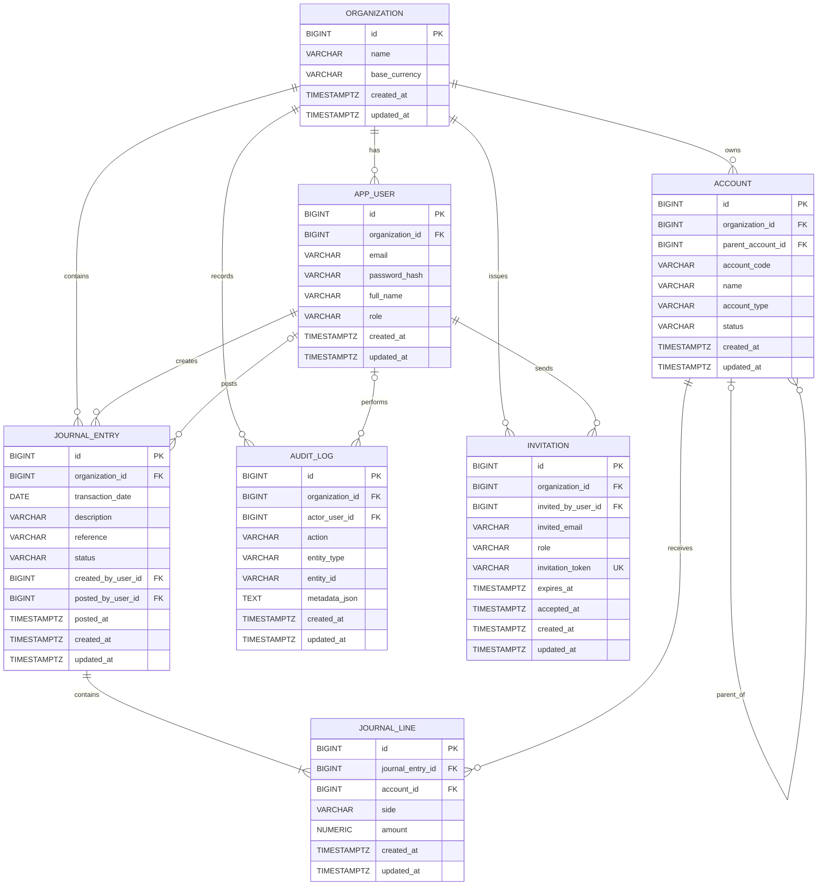
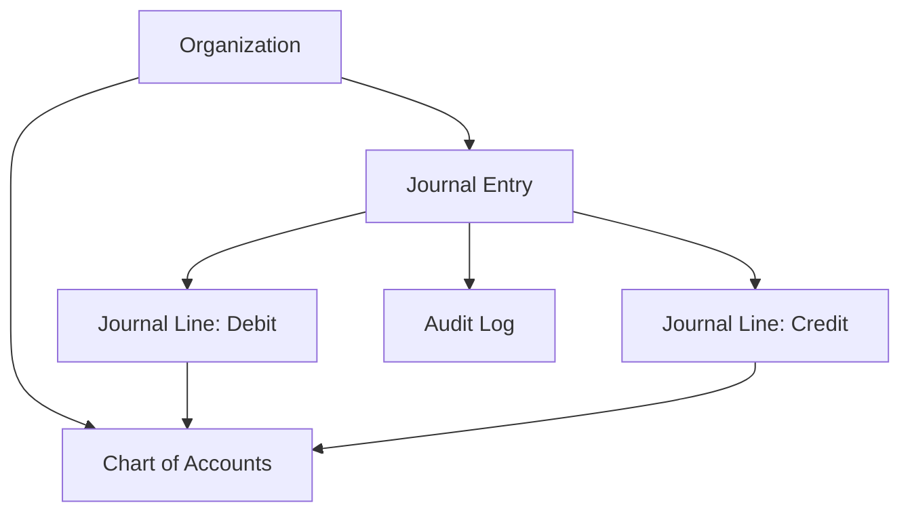

# Ledger Database — Entity Relationship Diagram (ERD)

## 1. ER Diagram

## 2. Relationship Summary

| Relationship                         | Cardinality          | Meaning                                                                     |
| ------------------------------------ | -------------------- | --------------------------------------------------------------------------- |
| Organization → App User              | One-to-many          | An organization has multiple users.                                         |
| Organization → Account               | One-to-many          | An organization owns its chart of accounts.                                 |
| Organization → Journal Entry         | One-to-many          | An organization contains journal entries.                                   |
| Journal Entry → Journal Line         | One-to-many          | A journal entry contains its debit/credit lines.                            |
| Account → Journal Line               | One-to-many          | An account can appear in multiple journal lines.                            |
| Account → Account                    | Self-referencing     | An account can have a parent account.                                       |
| App User → Journal Entry             | One-to-many          | A user can create multiple journal entries.                                 |
| App User → Journal Entry (posted by) | Optional one-to-many | A user can post multiple entries; an entry may not yet have a posting user. |
| Organization → Audit Log             | One-to-many          | An organization has audit records.                                          |
| App User → Audit Log                 | Optional one-to-many | An audit record may have an associated actor.                               |
| Organization → Invitation            | One-to-many          | An organization can issue multiple invitations.                             |
| App User → Invitation                | One-to-many          | A user can send multiple invitations.                                       |

## 3. Important Constraints

- **Primary keys (`PK`):** `id` in every table.
- **Foreign keys (`FK`):** Connect related tables and enforce referential integrity.
- **Unique constraints:** `(organization_id, email)` for users, `(organization_id, account_code)` for accounts, and `invitation_token` for invitations.
- **Check constraints:** Restrict user/invitation roles, account types/statuses, journal entry statuses, journal line sides, and positive journal line amounts.
- **Cascade deletion:** Deleting a journal entry also deletes its journal lines through `ON DELETE CASCADE`.
- **Tenant isolation:** Most business entities include `organization_id`. Application queries and authorization must ensure users cannot access another organization's records.

## 4. Accounting Flow

A journal entry groups multiple journal lines. Each line references an account and records a positive amount with a `DEBIT` or `CREDIT` side.

**Accounting invariant:** For a posted journal entry, the total debits must equal the total credits. Your current schema does not enforce this by itself; implement that validation in the posting transaction or an appropriate database-level mechanism.

## 5. Indexes

The schema defines indexes on organization IDs and journal-line foreign keys to help common filtering and join operations. The unique constraints also create supporting unique indexes in PostgreSQL.
